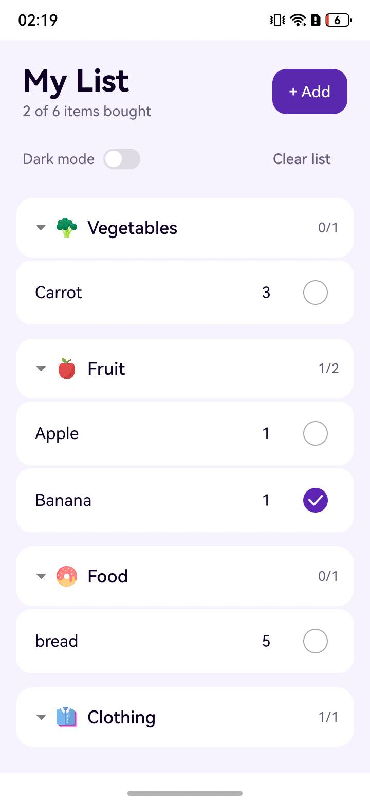

# MyList

MyList is an OpenHarmony phone example for managing a categorized shopping list with local storage.

## What this example demonstrates

| Capability | API or platform service | Where to look |
| --- | --- | --- |
| Add, edit, check off, and delete list items | ArkUI components and custom dialogs | [Index.ets](entry/src/main/ets/pages/Index.ets), [AddItemDialogue.ets](entry/src/main/ets/pages/components/AddItemDialogue.ets), [ShoppingListItem.ets](entry/src/main/ets/pages/components/ShoppingListItem.ets) |
| Group and collapse items by category, show bought counts, and switch light or dark colors | ArkUI state and list components | [Index.ets](entry/src/main/ets/pages/Index.ets), [Constants.ets](entry/src/main/ets/pages/Constants.ets) |
| Keep list items across app launches | `@kit.ArkData` `relationalStore` | [RDBUtil.ets](entry/src/main/ets/model/RDBUtil.ets), [ShoppingListItemTable.ets](entry/src/main/ets/model/ShoppingListItemTable.ets) |

## Preview



## Requirements

- An OpenHarmony phone running API 23 or later. The project compiles and targets API 23 and declares API 23 compatibility in [build-profile.example.json5](build-profile.example.json5).
- Node.js 22, Java 17, the OpenHarmony 6.1 (API 23) SDK and command-line tools, and `@oniroproject/oniro-app` 0.10.0 match the [CI build setup](.github/workflows/build.yml).
- Local development signing for a device build. `oniro-app sign` generates the signing files in the ignored `signatures/` directory.
- No runtime permissions or external services are required by the module manifest.

## Build and run

From the repository root in PowerShell:

```powershell
npm install -g @oniroproject/oniro-app@0.10.0
oniro-app sdk install 6.1
oniro-app cmdtools install
Copy-Item build-profile.example.json5 build-profile.json5
oniro-app sign
oniro-app build
oniro-app devices
oniro-app app install --device PHONE_SERIAL
oniro-app app launch --device PHONE_SERIAL
```

The example profile contains no signing credentials. Copy it and run `oniro-app sign` once per checkout; signing updates the local profile and creates local signing files. Both `build-profile.json5` and `signatures/` are ignored by Git. Later builds need only `oniro-app build`. Replace `PHONE_SERIAL` with the connected phone's serial from `oniro-app devices`. The signed HAP is written under `entry/build/default/outputs/default/`.

## Use

Tap **+ Add**, choose a category, enter a name and quantity, and tap **Add item**. Check an item to mark it bought; the header and category counts update. Tap an item's name or quantity to edit it. Swipe an item left to reveal **Delete**. Tap a category header to collapse or expand it, toggle **Dark mode** to change the colors, or use **Clear list** to remove all items after confirmation.

## Explore the implementation

[EntryAbility.ets](entry/src/main/ets/entryability/EntryAbility.ets) loads `pages/Index`. The page keeps the category lists and UI state, the components in [pages/components](entry/src/main/ets/pages/components) handle item rows and dialogs, and [ShoppingListItemTable.ets](entry/src/main/ets/model/ShoppingListItemTable.ets) stores items through the relational database helper.

## Verify

On the phone, add an item and confirm it appears in its category. Mark it bought and check that the counts change. Stop and relaunch the app, then confirm the item remains. Switch the theme and collapse a category to check the UI behavior.

`oniro-app build` should finish with **BUILD SUCCESSFUL**. Device behavior requires a connected phone for verification.

## Limitations

The light or dark selection is UI state and resets to light when the app is restarted. List items are stored locally on the device; the example does not sync them between devices.

## Contributing

These apps are focused examples of specific platform capabilities. Contributions that keep an example correct, buildable, and clear are welcome, including bug fixes, documentation and setup corrections, and improvements to its existing behavior. Please keep pull requests within the app's stated purpose and describe how you verified the change.

**Found a problem but can't fix it?** Open an issue in this repository; a pull request is not required. For a bug or broken build, include the steps to reproduce it, what you expected, what happened, and your device, OS, and SDK/API version. Logs or screenshots are helpful when available. You can also open an issue for inaccurate or unclear documentation.

## License

This project is licensed under the Apache License, Version 2.0. See [LICENSE](LICENSE).
